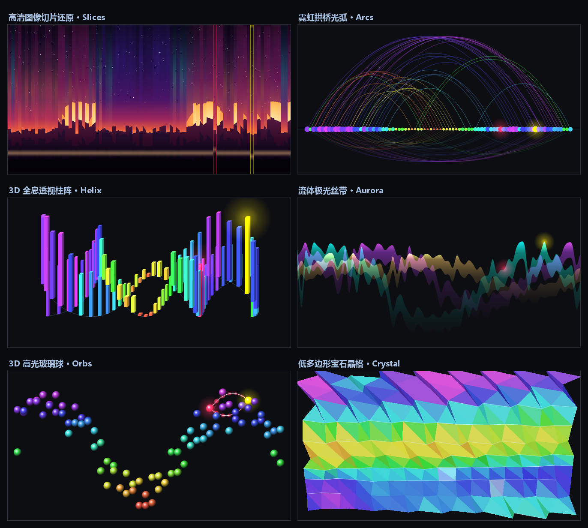
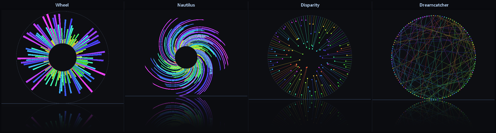
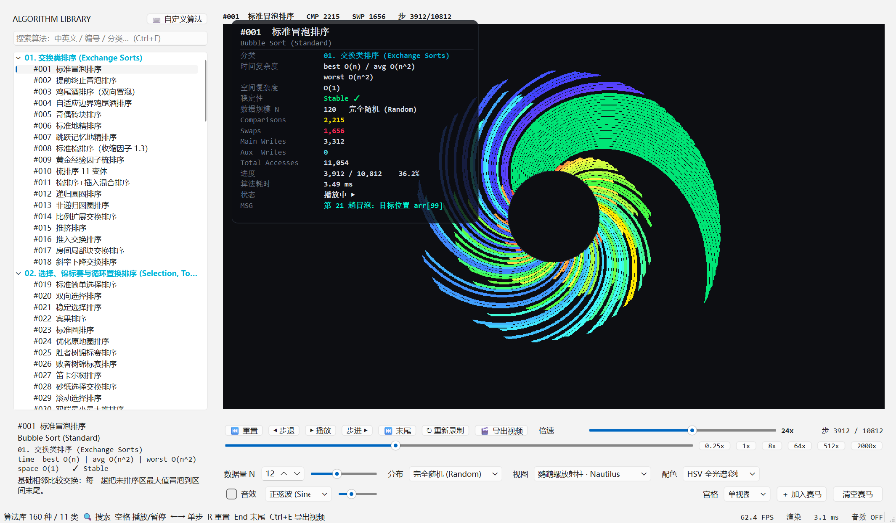
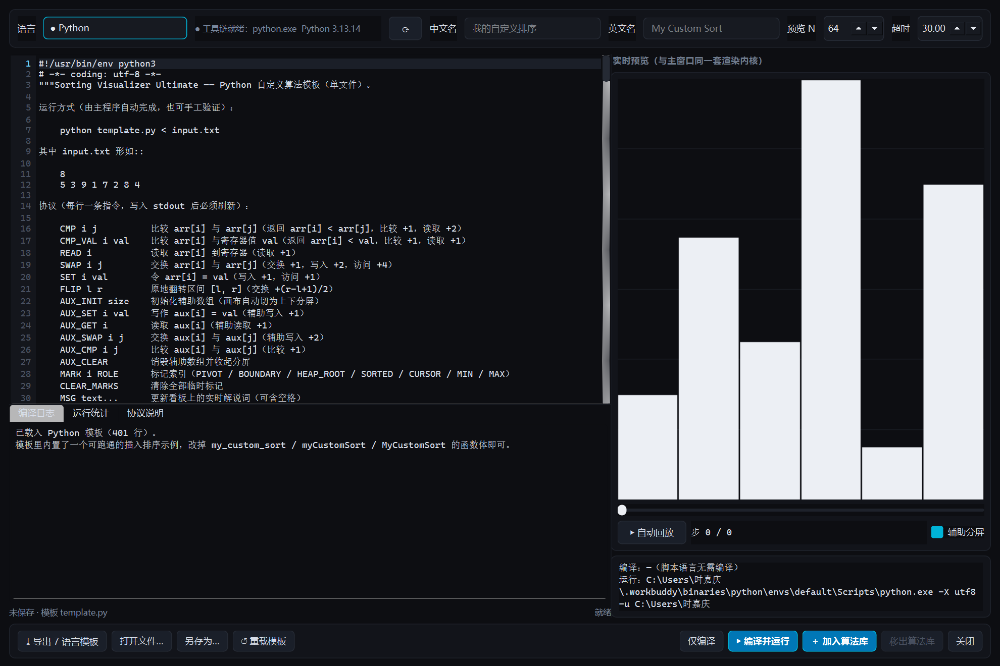
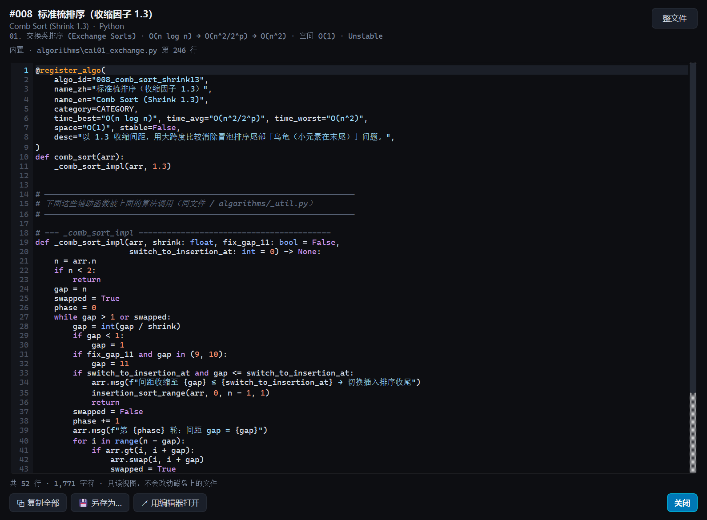
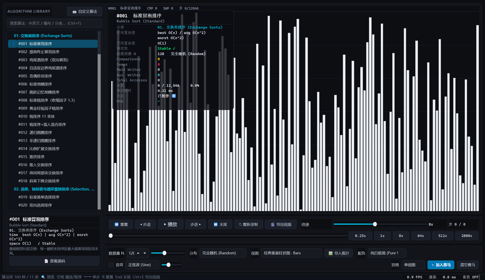

# Sorting Visualizer Ultimate

**160 种排序算法 × 18 种几何视图 × 多语言自定义算法工作室 × 1080P/4K 视频导出**

一个用 PySide6 + NumPy 写的排序算法可视化器。所有几何计算、柱体填充、点阵批绘都是 NumPy 向量化实现，全部视图实测 ≥ 60 FPS（1080P）。



---

## 下载免安装版

不想装 Python 环境？直接下打包好的 Windows 免安装版：

**➡️ [前往 Releases 下载 `SortingVisualizerUltimate_v1.0.0.rar`](../../releases/latest)**

解压后双击 `SortingVisualizerUltimate.exe` 即可运行（约 317 MB，已内置 FFmpeg，无控制台窗口，无需安装任何依赖）。

> 支持 Windows 10 / 11 x64。

---

## 功能

### 算法库：160 种，11 大类

| 分类 | 内容 |
|---|---|
| 交换类 | 冒泡、鸡尾酒、奇偶、地精、梳排序… |
| 选择类 | 选择、堆、锦标赛、循环置换… |
| 堆与树 | 二叉堆、偏序树辅助、堆排序变体… |
| 插入 / 希尔 | 直接插入、二分插入、希尔（多增量序列）… |
| 快速排序 | Lomuto、Hoare、三路、双轴、内省、introsort… |
| 归并排序 | 自顶向下、自底向上、原地、Tim 辅助… |
| 混合 / 分块 | TimSort、Block Merge、Wiki 排序… |
| 分配 / 基数 | 计数、桶、LSD / MSD 基数（辅助数组分屏展示）… |
| 排序网络 | 双调、奇偶归并、Batcher… |
| 煎饼 / 旋转 | 煎饼排序、旋转排序… |
| 深奥 / 教学 | 猴子排序、臭皮匠、Stooge、睡眠排序… |

### 18 种几何视图

前 12 种走 NumPy 光栅掩码管线，后 6 种走 `QPainter` 矢量管线（抗锯齿 / 渐变 / 加色混合），两者在同一个 `StyleRenderer.render(frame) -> (H, W, 3) uint8` 接口后面，界面与导出器完全无感 —— **屏幕上看到什么，导出的视频就是什么**。

- 基础：经典柱状图、径向花瓣环、峰谷折线
- 特色：对称声波、偏差收缩环、居中金字塔、残差火柴
- 创意：时空瀑布流、双轨织布机、鹦鹉螺放射柱、圆环捕梦网、隐式二叉树
- 次世代：高清切片还原、霓虹拱桥光弧、全息双螺旋、流体极光丝带、高光玻璃球、低多边形晶格

四条全局画质管线：全抗锯齿、动态余晖残影（1/4 分辨率 float32 累积层，含热源检测与包围盒上采样）、霓虹辉光 Plus 混合、黑曜石镜面倒影。




### 播放与对比

- 时间轴：播放 / 暂停 / 单步前进 / 单步后退 / 0.1x ~ 2000x 无级变速 / 拖动跳转
- 同屏赛马：单视图、双宫格、四宫格，同一起始数组公平对比谁先排完
- 辅助数组自动上下分屏（基数排序、归并排序这类需要额外空间的算法尤其直观）
- 3 套配色方案

### 自定义算法工作室

用自己喜欢的语言写排序算法，一键编译运行并加入算法树：

**C · C++ · Python · Java · Rust · Go · JavaScript (Node.js) · C# (.NET)**

- 自动探测本机工具链（并发探测 + 磁盘缓存，打开工作室 < 0.5 s）
- 编译错误、运行时错误、超时都有明确提示
- `arr.swap(i, j)` / `arr[i]` 两种取数写法，比较即记录为 `CMP` 事件
- 导入的算法会持久化保存，下次启动自动出现在算法树里

<p align="center">
  
  
</p>

### 查看源码

每个算法都能看源码，但源码不直接铺在界面上 —— 点档案卡底部的「📄 查看源码」（或 `Ctrl+U`、树右键菜单）：

- Python 用 `tokenize` 着色，其他语言走单遍状态机词法扫描
- 只展示真正参与排序的核心函数，BFS 追踪被调用的辅助函数（最多 3 个）
- 可切换「整文件」查看，支持复制、另存为、用外部编辑器打开



### 视频导出

工具栏「🎬 导出视频」或 `Ctrl+E`：1080P / 4K @ 30 ~ 120 FPS，H.264 MP4 + 立体声 AAC，音画完全同步。已内置 FFmpeg，开箱即用。

---

## 从源码运行

```bash
git clone https://github.com/nanakotoki/sorting-algorithm-visualization-collection.git
cd sorting-algorithm-visualization-collection
pip install -r requirements.txt
python main.py
```

必需依赖只有 `PySide6` 和 `numpy`；`sounddevice`（实时音效）与 `scipy`（WAV 写出）缺失时自动降级。

### 命令行模式

```bash
python main.py --list                      # 列出全部算法 ID
python main.py --algo quick_lomuto --n 256 # 指定算法 / 规模启动
python main.py --selftest --frames 40      # 自检：18 种视图全部渲染一遍并测帧率
python main.py --export out.mp4 --algo heap --style helix3d --res 4k --fps 60
```

完整参数见 `python main.py --help`。

### 打包

```bash
python build_exe.py            # 输出 dist/SortingVisualizerUltimate/
python build_exe.py --onefile  # 单文件模式
```

---

## 目录结构

```
algorithms/         160 种算法实现，按 11 个分类文件组织
core/               注册表、多语言运行器、源码定位与解析
ui/                 画布渲染器（18 种视图）、主窗口、源码查看器、算法工作室
exporter/           视频导出、音轨合成、HUD 叠加
sdk_templates/      8 种语言的自定义算法模板
tools/              自检与基准脚本
docs/               需求文档与截图
```

---

## 已知限制

- 免安装包仅提供 Windows x64 版本；其他平台请从源码运行
- C# 自定义算法依赖 .NET SDK，首次编译需还原依赖，会比较慢
- 猴子排序、睡眠排序这类教学算法在 n 较大时会跑很久，属预期行为

---

## 文档

- [Instruction3.md](docs/Instruction3.md) —— 次世代画质与视图升级需求
- [Instructions.md](docs/Instructions.md) / [Instructions2.md](docs/Instructions2.md) —— 初版与二版需求
